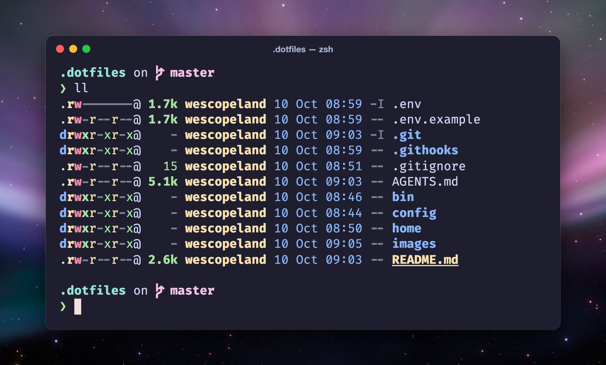

# dotfiles



My zsh setup for macOS on Apple Silicon. Clone it, run one command, and a new machine gets the same shell.

## Install

```bash
git clone https://github.com/wescopeland/dotfiles.git ~/.dotfiles
~/.dotfiles/bin/install
exec zsh
```

The install adds the Homebrew tools, links the zsh files into `~`, and creates `.env` from `.env.example`. Fill in `.env`. Git ignores it.

It is safe to run again. Use `--yes` to skip the prompt and `--no-brew` to skip Homebrew. Update with `~/.dotfiles/bin/update`.

## What you get

- [Starship](https://starship.rs) prompt, autosuggestions and autojump
- `ll` and `tree` through eza
- mise, pyenv and chruby for language versions
- `code <name>` and `cd <name>` that find git worktrees by name
- A pre-commit hook that blocks secrets, zsh syntax errors and shellcheck warnings

## Layout

| Path | Holds |
|---|---|
| `home/` | The zsh files. `functions/` and `projects/` hold one file per feature or project. |
| `config/Brewfile` | The tools the config calls. |
| `.env.example` | Every setting and secret, including repo paths. Copy it to `.env`. |
| `AGENTS.md` | Rules for AI agents, including the commit style. |

Wallpaper: Aurora from Mac OS X 10.5 Leopard.
